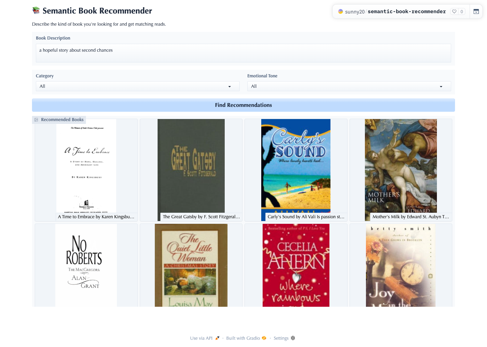

# 📚 Semantic Book Recommender

[](https://huggingface.co/spaces/sunny20/semantic-book-recommender)

Find your next read by *describing it*. Type something like *"a hopeful story
about second chances"*, optionally pick a category and an emotional tone, and
the app returns the most semantically similar books from a catalogue of ~5,000
titles.

It combines semantic search (OpenAI embeddings + a Chroma vector store) with
metadata filtering and emotion-based re-ranking, wrapped in a Gradio UI.

> **🚀 Live demo:** <https://huggingface.co/spaces/sunny20/semantic-book-recommender>



## ✨ Features

- **Natural-language search** over book descriptions using OpenAI embeddings.
- **Category filtering** by simplified genre (Fiction / Nonfiction, etc.).
- **Emotional-tone re-ranking** — Happy, Surprising, Angry, Suspenseful, Sad —
  derived from per-book emotion scores.
- **Persistent vector store** — the Chroma index is built once and reused, so
  you don't re-embed (or re-pay) on every run.
- **Tested, typed, linted** core logic with a CI pipeline.

## 🏗️ Architecture

```
query ──▶ Chroma similarity search ──▶ map hits back to catalogue
                                            │
                                  category filter (optional)
                                            │
                                emotional-tone re-rank (optional)
                                            │
                                     top-K results ──▶ Gradio gallery
```

The code is organised as a small package so each concern is isolated and
testable:

```
ai_book_recommendation/
├── app.py                     # entrypoint: wires everything together, launches UI
├── main.py                    # thin CLI wrapper / console script
├── book_recommender/          # application package
│   ├── config.py              # settings & constants (env-overridable)
│   ├── data.py                # load dataset, build embedding documents
│   ├── vector_store.py        # create / load the Chroma store
│   ├── recommender.py         # the recommendation engine (injectable store)
│   └── ui.py                  # Gradio UI + pure formatting helpers
├── tests/                     # pytest suite (no network / no API key needed)
├── notebooks/                 # data pipeline that produced the dataset
│   ├── 01_data_exploration.ipynb
│   ├── 02_text_classification.ipynb   # zero-shot genre categorisation
│   ├── 03_sentiment_analysis.ipynb    # per-book emotion scores
│   └── 04_vector_search.ipynb         # embedding / retrieval prototype
├── data/                      # books_with_emotions.csv (the app's dataset)
├── requirements.txt           # lean runtime deps (used by Hugging Face Spaces)
└── pyproject.toml             # full deps + dev tooling config
```

The recommendation engine takes its vector store as a dependency, which is what
makes it testable without OpenAI or Chroma — the tests inject a fake store.

## 🚀 Quickstart (local)

Requires Python 3.11+. This project uses [uv](https://docs.astral.sh/uv/), but
plain `pip` works too.

```bash
# 1. Clone
git clone https://github.com/senayberhe/ai_book_recommendation.git
cd ai_book_recommendation

# 2. Install (choose one)
uv sync                      # with uv
# pip install -e .           # with pip
# add --extra notebooks (uv) / pip install -e ".[notebooks]" only if you want to
# re-run the data-pipeline notebooks (pulls in torch, transformers, jupyter)

# 3. Add your OpenAI key
cp .env.example .env
# then edit .env and set OPENAI_API_KEY=sk-...

# 4. Run
python app.py
```

On the first run the app builds the Chroma index from the dataset (this calls
the OpenAI embeddings API and takes a few minutes). Subsequent runs load the
persisted index instantly. Open the local URL Gradio prints.

## 🐳 Run with Docker

No Python setup needed — just Docker and an OpenAI key.

```bash
cp .env.example .env          # then set OPENAI_API_KEY
docker compose up --build     # http://localhost:7860
```

Or without compose:

```bash
docker build -t book-recommender .
docker run --rm -p 7860:7860 --env-file .env -v chroma_data:/data book-recommender
```

The image is built from the lean `requirements.txt` (no torch/jupyter), runs as a
non-root user, and never contains your `.env` (see `.dockerignore`). The Chroma index
lives on the `chroma_data` volume, so it's built once on first start and reused after.
CI builds the image on every push to catch Dockerfile regressions.

## 🧪 Testing

The core logic is covered by a pytest suite that runs offline — no API key, no
network, no vector database required (a fake store is injected).

```bash
pip install -e ".[dev]"   # or: uv sync --extra dev
pytest                    # run the tests
ruff check .              # lint
mypy book_recommender     # type-check
```

CI runs lint + type-check + tests on every push and pull request — see
[`.github/workflows/ci.yml`](.github/workflows/ci.yml).

## 🌐 Deploy free on Hugging Face Spaces

Hugging Face Spaces hosts Gradio apps for free and gives you a public URL you
can put on a résumé.

1. Create an account at [huggingface.co](https://huggingface.co) and click
   **New Space**.
2. Choose **Gradio** as the SDK and the **free CPU basic** hardware.
3. Push this repository to the Space's git remote (or connect your GitHub repo).
   The YAML header at the top of this README configures the Space automatically.
4. In **Settings → Variables and secrets**, add a secret named `OPENAI_API_KEY`
   with your key. **Never commit the key** — it stays a secret on the Space.
5. The Space builds from `requirements.txt` and launches `app.py`. First boot
   builds the Chroma index, then the demo is live.

> **Cost note:** embeddings are billed by OpenAI per token. The dataset is
> embedded once; after that only short user queries are embedded, so ongoing
> cost is minimal. You can set spend limits in the OpenAI dashboard.

## 🔍 Does it actually work? Example queries

The whole point of semantic search is that it should return books that *fit
the vibe* of a query, not just keyword matches. Here's real output from the
live app for a few natural-language queries:

| Query | Filters | Top results |
|---|---|---|
| *"a hopeful story about second chances"* | — | *A Time to Embrace* (Karen Kingsbury), *The Great Gatsby* (F. Scott Fitzgerald), *Carly's Sound* (Ali Vali) |
| *"a tense thriller with a detective"* | Tone: Suspenseful | *Mystery Play* (Grant Morrison), *Different Seasons* (Stephen King), *Fat Tuesday* (Sandra Brown) |
| *"a lighthearted romantic comedy"* | Category: Fiction, Tone: Happy | *Every Boy's Got One* (Meg Cabot), *Chocolat* (Joanne Harris), *Millie's Fling* (Jill Mansell) |
| *"a deep dive into science and the universe"* | Category: Nonfiction | *Unweaving the Rainbow* (Richard Dawkins), *A Short History of Nearly Everything* (Bill Bryson), *The Future of Spacetime* (Hawking, Thorne, et al.) |

No keyword in any of these queries appears in the book titles above — the
matches come purely from embedding similarity between the query and each
book's description, which is what "semantic" is doing here.

## 📊 Dataset & pipeline

The dataset (`data/books_with_emotions.csv`) was produced by the notebooks in
`notebooks/`, starting from a public books dataset and enriching it with:

- **Simplified categories** via zero-shot text classification.
- **Emotion scores** (joy, fear, sadness, anger, surprise, …) via a
  text-classification sentiment model.

These columns power the category filter and the emotional-tone re-ranking.

## 🔒 Security

`.env` is git-ignored and must never be committed. If a key is ever exposed,
rotate it immediately in the OpenAI dashboard. Configuration is read from
environment variables, so secrets stay out of the code.

## 🛠️ Built with

Python · Gradio · LangChain · OpenAI Embeddings · Chroma · pandas ·
Transformers / scikit-learn (data pipeline) · pytest · ruff · mypy · Docker · GitHub Actions

## 📄 License

[MIT](LICENSE)
